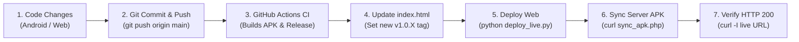

# ViralClip Studio — AI Memory, Continuity & Architecture Guide

> **Purpose:** This file is the primary memory and operational runbook for any AI agent or software engineer working on this repository across different devices, IDEs, or fresh sessions. Reading this document gives full context on the codebase, architecture, environment constraints, and end-to-end deployment workflows.

---

## 1. Project Identity & Repository Overview

- **Project Name:** ViralClip Studio
- **Package Name:** `com.mrpallanti.viralvideo`
- **GitHub Repository:** `Digitechguide/ViralClip-Studio` (Default branch: `main`)
- **Live Production URL:** [https://viral.mrpallanti.in/](https://viral.mrpallanti.in/)
- **Live APK Direct Link:** `https://viral.mrpallanti.in/ViralClip-Studio-v1.0.X.apk` (and generic `ViralClip-Studio.apk`)
- **Primary Function:** Converts 16:9 widescreen videos (YouTube URLs or local gallery videos) into 9:16 vertical short-form content (YouTube Shorts, Instagram Reels, TikTok) with creator-controlled precision cropping, on-device ML Kit face tracking, customizable branding/watermarks, and on-device GPU hardware encoding.

---

## 2. Technology Stack & Modules

### A. Android Client (`android/app`)
- **Language & UI:** Kotlin + Jetpack Compose (Material 3).
- **Architecture:** Clean Architecture (Presentation, Domain, Data) with MVI/MVVM reactive flows.
- **Media Engine:** AndroidX Media3 (`ExoPlayer` for frame scrubbing, `Transformer` for hardware-accelerated 60fps MP4 export).
- **Computer Vision:** Google ML Kit Face Detection (`com.google.mlkit:face-detection`) for real-time speaker auto-framing.
- **Stream Extraction:** On-device embedded `yt-dlp` (`io.github.junkfood:youtubedl-android`) + `FFmpeg`.

### B. Web Platform & Infrastructure (`api/`, `css/`, `js/`, `index.html`)
- **Landing Page:** Public responsive landing page at [viral.mrpallanti.in](https://viral.mrpallanti.in/) with dynamic APK download links.
- **Backend APIs:** PHP 8 on Apache with StackCDN (`api/auth.php`, `api/sync_apk.php`, `api/config.php`).
- **Deployment:** Automated FTP sync script (`deploy_live.py`) pulling credentials from `.env.deploy`.

---

## 3. Critical Environment & Build Rules (Read Before Running Commands!)

### ⚠️ Rule 1: NEVER Run `./gradlew` Locally on Windows
- **Why:** The local workstation JRE is 32-bit Java 8, which immediately fails with:
  `Could not reserve enough space for 2097152KB object heap`.
- **How to Build:** Always push code to the `main` branch. GitHub Actions (`.github/workflows/build-apk.yml`) runs on a 64-bit Ubuntu runner with Temurin JDK 17, compiles Kotlin, signs the APK, and creates a tagged GitHub Release automatically.

### ⚠️ Rule 2: Dynamic Semantic Versioning
- **How It Works:** GitHub Actions computes version dynamically based on git commit count:
  - `COMMIT_COUNT = $(git rev-list --count HEAD)`
  - `VERSION_CODE = COMMIT_COUNT`
  - `VERSION_NAME = "1.0.${COMMIT_COUNT}"`
  - `TAG_NAME = "v1.0.${COMMIT_COUNT}"`
- Before committing, check your current count with `git rev-list --count HEAD` to know what release tag will be generated (e.g. 58 commits = `v1.0.58`).

### ⚠️ Rule 3: Always Synchronize Live Web & Server Assets
- After GitHub Actions publishes the release, you must:
  1. Update `index.html` download buttons with the new version tag.
  2. Run `python deploy_live.py` to deploy web assets to FTP.
  3. Call `curl.exe -s "https://viral.mrpallanti.in/api/sync_apk.php?key=sync_salicylates_2026&tag=v1.0.X"` to pull the APK into server storage.
  4. Verify `HTTP 200 OK` on both the versioned and generic APK links.

---

## 4. Key Architectural Decisions & Past Solutions

### 1. YouTube Error 152 Bypassed via Auto-Caching
- **Problem:** Embedded YouTube iframe WebViews trigger `This video is unavailable. Error code: 152 - 4` due to YouTube origin restrictions.
- **Solution:** Never use WebViews for playback. When a YouTube URL is entered, `StudioViewModel.loadVideoForManualCropping()` automatically downloads the stream to `context.cacheDir` using on-device `yt-dlp`. Playback is always handled locally via `InAppVideoPlayer` (ExoPlayer), enabling zero-buffering 60fps frame scrubbing.

### 2. Elimination of Blurry 240p Stream Fallback
- **Problem:** YouTube throttles default streams and serves legacy pre-muxed video at 240p/360p, which looks heavily pixelated when cropped to 9:16 vertical short.
- **Solution:**
  - Enforced `bestvideo[height<=targetHeight][ext=mp4]+bestaudio[ext=m4a]` with fallback to `bestvideo+bestaudio`.
  - Added `--extractor-args youtube:player_client=ios,web,android` in `YoutubeStreamExtractorImpl.kt`.
  - Added resolution selector chips (`1080p Full HD`, `720p HD`, `1440p 2K`, `480p SD`).
  - Videos are cached separately per resolution as `${videoId}_${targetHeight}p.mp4`.

### 3. Precision Duration Trimming & Playhead Freezing
- **Problem:** Playhead timer continued running when setting start/end points, causing inaccurate clips.
- **Solution:**
  - Tapping `Set Start & Pause` or `Set End & Pause` explicitly pauses ExoPlayer (`exoPlayer.pause()`), sets `isPlaybackPaused = true`, seeks to the exact millisecond, and locks the trim marker.
  - Added `[-1s]` and `[+1s]` fine adjustment nudge buttons.
  - Playback auto-pauses when the playhead reaches `endSec`.

### 4. 9:16 Crop Placement & Smooth Animation
- **Problem:** Crop frame position jumped abruptly, and framing preset buttons wrapped awkwardly on small mobile screens.
- **Solution:**
  - Framing window uses `animateFloatAsState(targetValue = resolvedFraction, animationSpec = tween(250))` for smooth sliding.
  - Framing preset chips (`Auto Face-Track`, `Left 16%`, `Center 50%`, `Right 84%`, `Custom Slider`) are wrapped in `horizontalScroll(rememberScrollState())` with standard `BorderStroke`.
  - Header badge uses `Modifier.weight(1f)` on the title column and `maxLines = 1, softWrap = false` on the badge to prevent multi-line wrapping.

---

## 5. End-to-End Developer Runbook



### Detailed Commands:

```bash
# 1. Check status and commit count
git status
git rev-list --count HEAD

# 2. Stage and commit changes
git add -A
git commit -m "feat/fix: <your clear message>"
git push origin main

# 3. Monitor GitHub Actions build progress
python scratch/check_run.py

# 4. Once published, update index.html to new version
python -c "
with open('index.html', 'r', encoding='utf-8') as f:
    text = f.read()
# replace old tag with new tag
with open('index.html', 'w', encoding='utf-8') as f:
    f.write(text.replace('v1.0.PREV', 'v1.0.NEW').replace('1.0.PREV', '1.0.NEW'))
"

# 5. Commit & deploy web assets
git add index.html
git commit -m "chore(web): update download links for release v1.0.NEW"
git push origin main
python deploy_live.py

# 6. Stream APK from GitHub Release to viral.mrpallanti.in server storage
curl.exe -s "https://viral.mrpallanti.in/api/sync_apk.php?key=sync_salicylates_2026&tag=v1.0.NEW"

# 7. Verify live production link returns HTTP 200 OK
curl.exe -I "https://viral.mrpallanti.in/ViralClip-Studio-v1.0.NEW.apk"
curl.exe -I "https://viral.mrpallanti.in/ViralClip-Studio.apk"
```

---

## 6. Directory Map & File Quick Reference

| Directory / File | Description |
|---|---|
| `android/app/src/main/java/.../presentation/ui/components/CustomClipperView.kt` | The heart of the clipper: interactive seekbar, video player, quality chips, Start/End trimming cards, animated 9:16 framing box, hook text, and export CTA. |
| `android/app/src/main/java/.../presentation/ui/StudioScreen.kt` | Primary dashboard: source input card, URL paste handler, quality chips, 9:16 phone mockup, bottom navigation host. |
| `android/app/src/main/java/.../presentation/viewmodel/StudioViewModel.kt` | Reactive state manager (`StudioUiState`), auto-cache handler, trim calculation, quality selection. |
| `android/app/src/main/java/.../data/local/Media3TransformerVideoRendererImpl.kt` | Hardware video encoder, dynamic 9:16 crop box, quality resolution scaler (1080p, 720p, 2K, 480p). |
| `android/app/src/main/java/.../data/remote/YoutubeStreamExtractorImpl.kt` | yt-dlp format selector, high-bitrate stream extraction, quality-tagged caching (`${videoId}_${quality}p.mp4`). |
| `android/app/src/main/java/.../data/local/FaceTrackingHelper.kt` | Google ML Kit on-device face detector calculating speaker horizontal center. |
| `.github/workflows/build-apk.yml` | GitHub Actions CI/CD workflow building and publishing APK releases. |
| `deploy_live.py` | Python FTP script uploading web files to `ftp.mrpallanti.in`. |
| `api/sync_apk.php` | Server endpoint streaming GitHub Release APK directly to server root. |
| `PROJECT_ARCHITECTURE_AND_FLOW.md` | In-depth engineering architecture specifications and data models. |

---

*This guide preserves full project memory and allows any AI or engineer to resume development seamlessly on any machine.*
