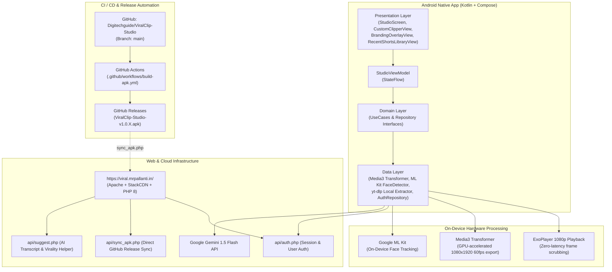
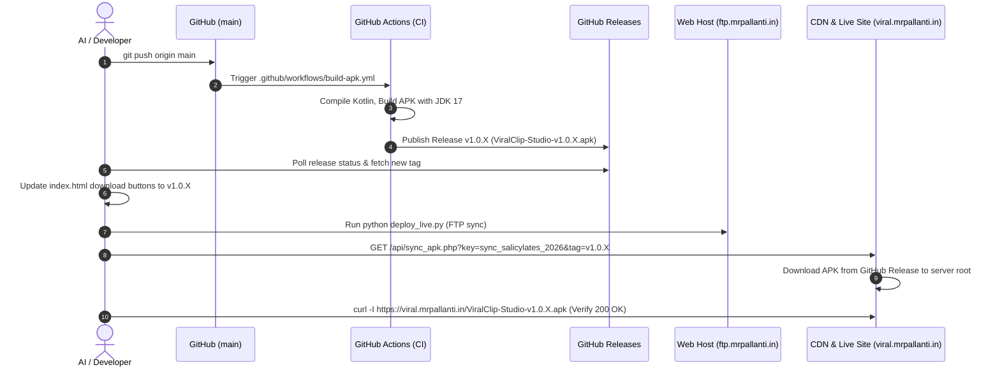

# ViralClip Studio — Architecture, Workflow & Developer Guide

> **Durable Project Memory & AI Context Document**  
> *Keep this file updated whenever architecture, workflows, or deployment processes change.*

---

## 1. Executive Summary & Product Overview

**ViralClip Studio** (`com.mrpallanti.viralvideo`) is a dual-platform application (Native Android App + Web Studio) designed to convert long-form horizontal videos (16:9 YouTube, Podcasts, Interviews, Game streams) into high-engagement vertical short-form videos (9:16 for YouTube Shorts, Instagram Reels, and TikTok).

### Key Features
1. **Gemini AI Viral Hooks Analysis:** Automatically extracts video transcripts, analyzes emotional triggers, retention hooks, and punchlines using Google Gemini Flash, outputting recommended timestamps and viral captions.
2. **Custom Length & Place Cropper:** Allows creators to manually scrub videos with micro-step precision (`-1s`, `+1s`, `-5s`, `+5s`), set start/end markers with instant timer pause, and choose horizontal crop placement (`Left Focus 16%`, `Solo Center 50%`, `Right Focus 84%`, `Custom Slider 0-100%`, or `Auto Face-Track`).
3. **On-Device ML Kit Face Tracking:** Uses Google ML Kit Face Detection to follow the active speaker across 16:9 widescreen footage and automatically keep them centered inside the 9:16 vertical crop window.
4. **Hardware-Accelerated On-Device Rendering:** Employs AndroidX Media3 Transformer to render and encode 1080x1920 60fps MP4 videos directly using on-device GPU/hardware encoders, saving them straight to the user's Phone Gallery (`DCIM/ViralClips`).
5. **Branding & Watermark Engine:** Adds custom transparent PNG logos, customizable watermarks (opacity & position), and viral hook captions with configurable color schemes.
6. **Recent Shorts Library:** Local persistent history of generated shorts with in-app playback, file size metrics, and one-tap Android system share.

---

## 2. System Architecture & Tech Stack



---

## 3. Directory Structure & Key Files

```
├── .github/workflows/
│   └── build-apk.yml                 # Automated CI/CD pipeline: Kotlin build, APK signing, GitHub Release
├── android/
│   ├── app/src/main/
│   │   ├── AndroidManifest.xml       # Permissions (Internet, Storage), Hardware acceleration, Deep Links
│   │   └── java/com/mrpallanti/viralvideo/
│   │       ├── ViralVideoApp.kt      # Application entrypoint
│   │       ├── data/
│   │       │   ├── local/
│   │       │   │   ├── AuthSessionManager.kt              # Encrypted local user credentials
│   │       │   │   ├── FaceTrackingHelper.kt              # Google ML Kit Face Detection
│   │       │   │   ├── GeneratedShortsRepositoryImpl.kt  # Local JSON/SQLite storage of recent clips
│   │       │   │   ├── Media3TransformerVideoRendererImpl.kt # On-device hardware video encoder
│   │       │   │   └── VideoOverlayHelper.kt              # Canvas overlay for captions, logos, watermarks
│   │       │   └── remote/
│   │       │       ├── AuthRepositoryImpl.kt              # Connects to https://viral.mrpallanti.in/api/auth.php
│   │       │       ├── GeminiFlashApiClient.kt            # Direct calls to Gemini Flash API
│   │       │       └── YoutubeStreamExtractorImpl.kt      # yt-dlp & extractor wrapper
│   │       ├── domain/
│   │       │   ├── model/ (AuthUser.kt, Models.kt)       # Data classes (ViralClip, OverlayConfig, etc.)
│   │       │   ├── repository/ (AuthRepository.kt, Repositories.kt)
│   │       │   └── usecase/UseCases.kt                    # Clean Architecture domain use cases
│   │       └── presentation/
│   │           ├── MainActivity.kt                        # Compose root host & intent URL receiver
│   │           ├── ui/
│   │           │   ├── LoginScreen.kt                     # Modern studio dark login/register UI
│   │           │   ├── StudioScreen.kt                    # Primary dashboard & tabs coordinator
│   │           │   ├── components/
│   │           │   │   ├── CustomClipperView.kt           # Transport bar, dual trim cards, rule-of-thirds grid
│   │           │   │   ├── BrandingOverlayView.kt         # Logo picker, watermark position/opacity sliders
│   │           │   │   ├── RecentShortsLibraryView.kt     # Gallery of exported videos with share/delete
│   │           │   │   ├── StudioTabs.kt                  # Glowing 24dp studio bottom navigation bar
│   │           │   │   ├── InAppVideoPlayer.kt            # ExoPlayer player view with state synchronization
│   │           │   │   └── InAppYouTubePlayer.kt          # Embedded iframe fallback player
│   │           │   └── theme/ (Color.kt, Theme.kt)        # Dark studio aesthetic color tokens
│   │           └── viewmodel/
│   │               └── StudioViewModel.kt                 # Central reactive state manager (MVI/MVVM)
├── api/
│   ├── auth.php                      # User authentication, registration, session checks
│   ├── config.php                    # Server configuration & security headers
│   ├── download.php                  # Web download proxy helper
│   ├── info.php                      # Video metadata helper
│   ├── suggest.php                   # Viral hooks suggestion endpoint
│   └── sync_apk.php                  # Direct cURL streaming sync from GitHub Releases to server storage
├── css/                              # Web landing & studio stylesheets
├── js/                               # Web engine scripts (video-engine.js, ai-analyzer.js, app.js)
├── .env.deploy                       # Deployment credentials (FTP credentials for ftp.mrpallanti.in)
├── deploy_live.py                    # Automated FTP upload script for web platform
├── index.html                        # Public landing page with APK download buttons
├── studio.html                       # Web-based studio alternative
└── admin.html                        # Web administration portal
```

---

## 4. Key Engineering Workflows

### Flow A: AI Viral Hooks Workflow
1. User enters YouTube URL in **AI Studio** tab or selects local file from gallery.
2. `StudioViewModel.fetchAndAnalyze()` is called.
3. Audio/transcript is processed and evaluated by Gemini Flash for virality score (0–100), start/end timestamps, and hook text.
4. UI presents ranked viral recommendation cards.
5. Tapping a card populates the trim range and transitions into the **Clipper** view.

### Flow B: Custom Length & Place Cropper Workflow
1. User clicks **"Manual Length & Place Cropper"** or taps the **Clipper** tab.
2. `StudioViewModel.loadVideoForManualCropping()` runs:
   - If the video is not cached locally, the on-device `yt-dlp` engine **auto-downloads** the 1080p stream to `context.cacheDir`.
   - The UI shows an animated **"Auto-Caching Video Offline..."** indicator, bypassing YouTube WebView Error 152.
3. Once cached, `InAppVideoPlayer` (ExoPlayer) loads the MP4 locally:
   - Playhead scrub has **0 buffering** and runs at 60fps.
   - Clicking **"Set Start & Pause"** or **"Set End & Pause"** immediately pauses ExoPlayer, sets `isPlaybackPaused = true`, seeks to the exact position, and updates the timestamp marker.
4. User selects framing placement:
   - `🤖 Auto Face-Track`: Continuously tracks speaker with ML Kit.
   - `👈 Left (16%)` | `🎯 Center (50%)` | `👉 Right (84%)`: Standard interview/podcast presets.
   - `🎚️ Custom Slider`: Smooth horizontal offset (0.0 to 1.0).
5. User clicks **"Export Vertical Short"**:
   - `Media3TransformerVideoRendererImpl` executes hardware encoding.
   - Saves final 1080x1920 MP4 into phone gallery (`DCIM/ViralClips`).

---

## 5. Deployment & Release Protocol

> **CRITICAL RULE:** Any changes made to the codebase must follow this automated deployment protocol to ensure the live website and GitHub release stay 100% in sync.



### Step-by-Step Release Checklist:
1. **Commit & Push:**
   ```bash
   git add .
   git commit -m "feat/fix: <description>"
   git push origin main
   ```
2. **Monitor GitHub Actions CI:**
   - CI builds with JDK 17, dynamic versioning (`v1.0.X`), and outputs `ViralClip-Studio-v1.0.X.apk`.
   - Use `https://api.github.com/repos/Digitechguide/ViralClip-Studio/releases/latest` to check when published.
3. **Update Web Landing Page:**
   - Update `index.html` download buttons with the new version tag `v1.0.X`.
   - Run `python deploy_live.py` to upload updated web assets to `ftp.mrpallanti.in`.
4. **Synchronize APK on Server:**
   - Run via `curl.exe`:
     ```bash
     curl.exe -s "https://viral.mrpallanti.in/api/sync_apk.php?key=sync_salicylates_2026&tag=v1.0.X"
     ```
   - Confirm JSON response: `{"status":"success","tag":"v1.0.X","bytes":...}`.
5. **Verify Live Production Link:**
   ```bash
   curl.exe -I "https://viral.mrpallanti.in/ViralClip-Studio-v1.0.X.apk"
   ```
   Must return `HTTP/1.1 200 OK` with non-zero `content-length`.

---

## 6. Known Gotchas & Architectural Decisions

1. **YouTube WebView Error 152:**
   - YouTube blocks embedded playback inside Android WebViews (`Error code: 152 - 4`).
   - *Architecture Rule:* **Never rely on YouTube WebView iframes for trimming or scrubbing.** Always auto-cache the video offline using `yt-dlp` and play the local MP4 using `InAppVideoPlayer` (ExoPlayer).
2. **Smart-Casting on Delegated State in Jetpack Compose:**
   - In Compose, delegated properties (`val state by viewModel.uiState.collectAsState()`) have open getters, so Kotlin cannot smart-cast nullable properties like `state.currentVideo.localUri`.
   - *Architecture Rule:* Always use safe navigation (`state.currentVideo?.localUri.isNullOrBlank()`).
3. **Player Controls Collision & Timer Freezing:**
   - ExoPlayer's built-in `PlayerView` overlay controls must be disabled (`useController = false`) because `CustomClipperView` provides its own precision transport controls.
   - Always wire `onIsPlayingChanged` to keep Compose state (`isPlaybackPaused`) perfectly in sync with the underlying player.
4. **Local Development Environment (32-bit Java 8 vs 64-bit JDK 17):**
   - The local workstation runs 32-bit Java 8 which cannot allocate the 2GB Gradle daemon heap.
   - *Architecture Rule:* All APK compilation and releases are executed via the GitHub Actions runner (`.github/workflows/build-apk.yml`) on Ubuntu with JDK 17.
5. **FTP & CDN Credentials:**
   - FTP credentials are stored in `.env.deploy` (git-ignored for security).
   - Sync endpoint secret key is `sync_salicylates_2026`.

---

*This guide guarantees that any future developer or AI agent can immediately understand, maintain, debug, and release ViralClip Studio without losing context.*
